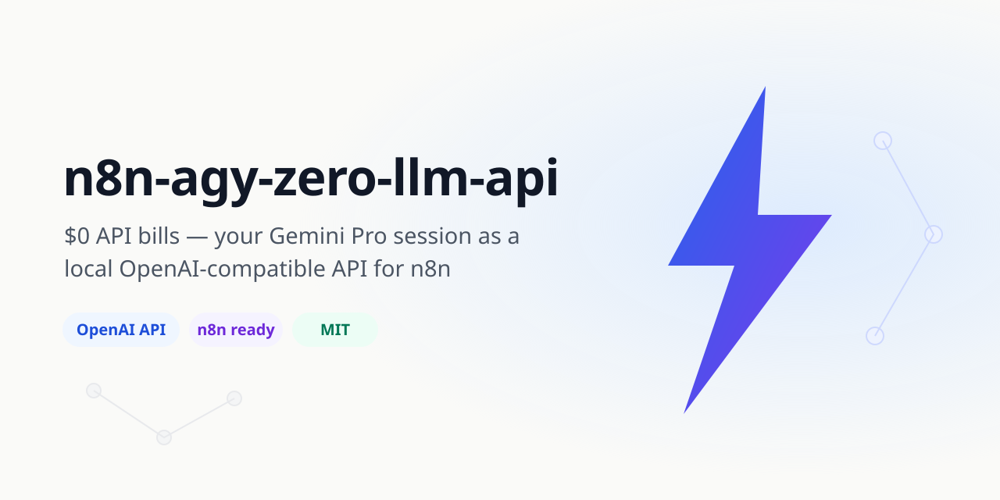
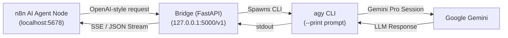

<div align="center">



# ⚡ n8n-agy-zero-llm-api

### Run AI agents in n8n with **$0.00** in API bills.

**Your Google Gemini Pro / Antigravity session, exposed as a local OpenAI-compatible API — so every n8n AI node just works, with zero per-token fees.**

[](LICENSE)
[]()
[]()
[]()
[]()
[](https://github.com/umairismail233/n8n-agy-zero-llm-api)

[Quickstart](#-quickstart-3-double-clicks) •
[Why This Bridge](#-cost--architecture-comparison) •
[How it works](#-how-it-works) •
[API reference](#-api-reference) •
[FAQ](#-faq) •
[Contributing](CONTRIBUTING.md)

</div>

---

## 🎯 The problem

n8n's AI Agent nodes, Chat Hub, and assistants all expect an **OpenAI-style API** — which normally means handing OpenAI or Anthropic your credit card and paying per token, forever.

If you already pay for **Google Gemini Pro / Advanced** (or run the Antigravity IDE), you're *already* paying for a frontier model. This bridge lets n8n spend that subscription instead of a second API bill.

## 📊 Cost & Architecture Comparison

| Feature | OpenAI / Anthropic Direct | Local Ollama | ⚡ n8n-agy-zero-llm-api |
|---|---|---|---|
| **Monthly API Bill** | 💸 $20 - $100+/mo per-token fees | $0.00 | **$0.00 extra** (Uses existing Gemini Pro plan) |
| **Model Quality** | Frontier (GPT-4o, Sonnet) | Limited by local hardware | **Frontier Intelligence (Gemini 1.5 Pro)** |
| **Hardware Required** | Low (Cloud) | Heavy GPU (16GB+ VRAM required) | **Ultra-lightweight (Runs on standard PC / 4GB RAM)** |
| **Credit Card on File** | Required | Not required | **None required** |
| **n8n Drop-In Ready** | Yes | Needs custom model config | **100% Native Drop-in** (`/v1/chat/completions`) |
| **Streaming Support** | Yes | Varies | **Full SSE Streaming (`stream: true`)** |
| **Setup Experience** | Manual API keys | Complex CLI setup | **1-Click Self-Healing Windows Launchers** |

## ✨ What this gives you

| Capability | Details |
|---|---|
| **OpenAI-compatible endpoint** | `POST /v1/chat/completions` (with streaming), `/v1/responses`, `/v1/models`, `/v1/embeddings` — drop-in for n8n's OpenAI credentials |
| **Real model, zero marginal cost** | Prompts are executed through your local Antigravity CLI session (`agy`), backed by your Gemini Pro plan |
| **1-click onboarding portal** | Browser-based pairing at `http://127.0.0.1:5000/setup` — no terminal spelunking |
| **n8n-aware extras** | Auto chat-title generation for the n8n Chat Hub, LangChain-safe model aliases, graceful fallbacks |
| **Programmatic workflow control** | `deploy_workflow.py` lists, inspects, and deploys workflows straight to your n8n canvas via its REST API |
| **Self-healing launchers** | The `.bat` launchers detect missing Python / Node.js / n8n and install them for you |
| **100% local** | Everything binds to `127.0.0.1`. No cloud relay, no telemetry, no data leaves your machine |

## 🏗️ How it works



1. Point n8n's OpenAI credential at `http://127.0.0.1:5000/v1` with model `agy-local-engine`.
2. The bridge translates the request and runs it through your local `agy` CLI (your Antigravity / Gemini Pro session).
3. The response streams back to n8n exactly like OpenAI would return it.

## 🚀 Quickstart (3 double-clicks)

> **Prerequisites:** Windows 10/11. Python, Node.js, and n8n are *optional* — the launchers install whatever is missing.

**Step 0 — (optional) verify your system**
Double-click `0-verify-system.bat`. It checks for Python 3.10+, Node.js LTS, and n8n, silently installing anything missing.

**Step 1 — start the bridge & link your account**
Double-click `1-start-bridge.bat`.
- Creates a virtualenv, installs dependencies, and starts the bridge on port `5000`.
- On first run it opens the onboarding portal (`http://127.0.0.1:5000/setup`) in Chrome — click **🔗 1-Click Link** to pair your session.
- Your token is stored in a local `.env` file. Nothing is uploaded anywhere.

> ⚠️ Keep this terminal window open while you work in n8n.

**Step 2 — start n8n**
Double-click `2-start-n8n.bat`. n8n launches on `http://localhost:5678` and your browser opens automatically.

**Step 3 — chat & automate**
- **Chat Hub** (`http://localhost:5678/home/chat`): New Chat → model `agy-local-engine` is pre-connected.
- **Workflow canvas**: import `workflows/starter-chat-workflow.json` and point any AI node at the bridge.

### Manual setup (no .bat files)

```bash
# 1. Configure
cp .env.example .env          # then fill in your values

# 2. Install
python -m venv venv && venv\Scripts\activate
pip install -r requirements.txt

# 3. Pair your session
python setup_credentials.py

# 4. Run the bridge
uvicorn main:app --host 127.0.0.1 --port 5000
```

## 🔌 API reference

Base URL: `http://127.0.0.1:5000` · Default model: `agy-local-engine`

| Method & path | Purpose |
|---|---|
| `POST /v1/chat/completions` | Chat completions, OpenAI schema, `stream: true` supported (SSE) |
| `POST /v1/responses` | Responses API (streaming supported) |
| `GET /v1/models` | Model list — includes `gpt-4o`, `gpt-3.5-turbo`, … aliases so n8n/LangChain dropdowns work |
| `GET /v1/models/{id}` | Single-model lookup (prevents LangChain `MODEL_NOT_FOUND` 404s) |
| `POST /v1/embeddings` | Embeddings endpoint |
| `GET /health` | Health check |
| `GET /setup` | 🌐 Browser onboarding portal |
| `GET /api/status` | Bridge status JSON |
| `POST /api/pair` | 1-click session pairing |
| `POST /api/setup` | Save a token from the portal |

### Pointing n8n at the bridge

In n8n, create **OpenAI credentials** with:
- **Base URL:** `http://127.0.0.1:5000/v1`
- **API Key:** anything (e.g. `local`) — auth happens via your paired session, not this field
- **Model:** `agy-local-engine`

### Deploying workflows from the terminal

```bash
# List workflows in your local n8n
python deploy_workflow.py list

# Inspect one
python deploy_workflow.py get <workflow_id>

# Deploy the starter template and activate it
python deploy_workflow.py deploy workflows/starter-chat-workflow.json --activate
```

## 📁 Project structure

```
n8n-agy-zero-llm-api/
├── main.py                  # FastAPI bridge — OpenAI-compatible API on :5000
├── setup_credentials.py     # Interactive session-pairing → writes local .env
├── deploy_workflow.py       # CLI: list / get / deploy n8n workflows via REST
├── requirements.txt         # fastapi, uvicorn, pydantic, python-docx
├── .env.example             # Copy to .env — never commit real secrets
├── 0-verify-system.bat      # Pre-flight check + auto-installer
├── 1-start-bridge.bat       # Launches the bridge + onboarding portal
├── 2-start-n8n.bat          # Launches n8n on :5678
├── bin/
│   ├── agy / agy.cmd        # Local Antigravity CLI shims
│   └── agy.mjs              # Node runtime: Gemini call w/ local fallback
├── workflows/
│   └── starter-chat-workflow.json   # Import-ready n8n starter template
├── assets/                  # Repo artwork
└── docs/                    # Screenshots & guides
```

## ❓ FAQ

**Do I need Docker?**
No. n8n and the bridge run natively — no containers, no overhead.

**Do I need to pay OpenAI / Anthropic?**
No. That's the whole point — the bridge spends your existing Gemini Pro / Antigravity session instead.

**What if Python or Node.js isn't installed?**
The launchers detect that and install the official builds silently.

**n8n shows an "Add a code sandbox" modal on `/assistant`?**
Just close it (✕, top-right). It's n8n's cloud wizard — your local Chat Hub and AI Agent nodes don't need it.

**Is my token safe?**
It lives in `.env` on your machine only (which is git-ignored). The bridge binds to `127.0.0.1` — nothing is reachable from your network, let alone the internet. See [SECURITY.md](SECURITY.md).

**Does this work on macOS / Linux?**
The bridge itself (`main.py`) is cross-platform — run it with `uvicorn` directly. The one-click `.bat` launchers are Windows-only; PRs for `.sh` equivalents are welcome!

## 🤝 Contributing

Issues and PRs are welcome — see [CONTRIBUTING.md](CONTRIBUTING.md). If this saved you an API bill, a ⭐ is the cheapest thank-you there is.

## 📄 License

MIT — see [LICENSE](LICENSE). Built with n8n, FastAPI, and a healthy dislike of per-token billing.
